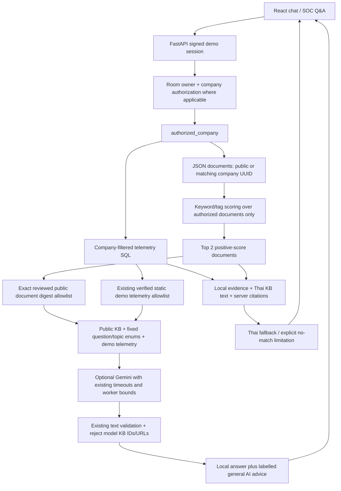

# Phase A–B: AI Chatbot + JSON Knowledge Base

วันที่ตรวจ: 3 พฤศจิกายน 2026 (Asia/Bangkok). Deadline: 9 พฤศจิกายน 2026.
Scope: Phase A/B only. Phase C has not started.

## Source and preservation

- Initial branch: `main`, commit `8b9f5df`.
- Working branch: `feature/ai-kb-phase-ab`, created from that existing HEAD.
- Pre-existing untracked `AI_EVALUATION.md` and `backend/tests/test_ai_evaluation.py` were preserved without edits. The latter is included in the offline regression run.
- No dependency, database migration, schema, ticket workflow, SLA, .env, commit, push, deployment, or live Gemini changes/calls.
- Older README/runbooks describe earlier implementations; this evidence covers the current Phase A/B source only.

## Phase A runtime evidence and blocker

`sudo pg_ctlcluster 16 main start` succeeded; cluster 16/main is online on 5432.
The application's read-only connection check failed with PostgreSQL password authentication failure.
A local administrative read-only catalog query listed only the non-template database `postgres`.
This does not prove why the previous demo database is absent; no reset, seed, role creation,
database creation or restore was attempted. No production data was modified.

The runbook FastAPI startup was attempted with `GEMINI_ENABLED=false` in the process environment
(.env unchanged). Uvicorn exited with status 3 during database startup; `/` on 8000 is unavailable.
There is no successful PostgreSQL application health check or login/E2E result for this run.
Vite started on 127.0.0.1:5173 and returned HTTP 200. Its page being available does not imply
backend health. After the interrupted tool turn, Vite was restarted; see runtime-checks.txt.

Playwright's existing JavaScript package is available, but its Chromium executable is absent;
no browser executable was found. No browser was installed. **No screenshots were captured**,
and no fabricated screenshot or mockup is presented as a system screenshot.

Separate decision needed: restore the known demo DB from an authorized backup, or explicitly
approve creating a fresh synthetic demo DB and credentials. Do not guess/reset credentials.
After database recovery, start with `GEMINI_ENABLED=false` until live inference is separately approved.

## Architecture and data flow (implemented)



The raw question is used locally for keyword retrieval. Gemini receives neither the raw question,
raw transcript nor company-private KB documents. History remains a bounded projection to fixed
topic enums. Existing authorization, static telemetry whitelist, no-tools configuration, timeouts,
worker bounds and output text validation are retained.

`POST /api/customer-data/ask`, private chat messages and the compatibility `/api/chat` share
`answer_question`. The compatibility endpoint retains its old response shape; citations appear
in the answer text. Q&A adds `citations`, `retrieval="keyword_tag"` and `kb_status` fields.
Private chat stores citations in the assistant text, so ticket-linked transcripts retain them
without a database migration. SUPPORT replies do not invoke Gemini. Ticket ownership/status/assignment
behavior is preserved.

## KB contract and review

File: `backend/data/soc_knowledge.json`, 10 short Thai articles, all public in the submission catalog.
Company-private records are supported by exact company UUID and exercised only with synthetic test fixtures.
Each article contains `id`, `title`, `content`, `tags`, `scope`, `company_id`, `source` and `review`.

Review here means editorial review by the coding assistant against the linked primary sources,
with conservative wording, no invented incident facts and no claims of actions performed.
It is **not independent human SOC approval**, a quality score or an evaluation by university staff.
Human review remains recommended before submission.

| ID | Topic | Primary source |
| --- | --- | --- |
| KB-001 | Suspicious login | [ASD ACSC and partners: event logging](https://www.cyber.gov.au/publication/best-practices-for-event-logging-and-threat-detection) |
| KB-002 | MFA | [NCSC: 2-Step Verification](https://www.ncsc.gov.uk/guidance/setting-2-step-verification-2sv) |
| KB-003 | Phishing | [NCSC: spotting scams](https://www.ncsc.gov.uk/collection/phishing-scams/spot-scams) |
| KB-004 | SIEM alert triage | ASD ACSC and partners, linked above |
| KB-005 | Incident response | [NIST SP 800-61 Rev. 3](https://csrc.nist.gov/pubs/sp/800/61/r3/final) |
| KB-006 | Malware/ransomware | [Microsoft incident response](https://learn.microsoft.com/en-us/security/ransomware/incident-response-playbook-dart-ransomware-approach) |
| KB-007 | Port scan/firewall | ASD ACSC and partners, linked above |
| KB-008 | Missing logs | [OWASP Logging Cheat Sheet](https://cheatsheetseries.owasp.org/cheatsheets/Logging_Cheat_Sheet.html) |
| KB-009 | Recovery/backups | Microsoft incident response, linked above |
| KB-010 | Sensitive log data | OWASP Logging Cheat Sheet, linked above |

Some CISA pages returned HTTP 403 during source research; those inaccessible pages are not used
as the catalog's cited sources. The alternatives above were readable primary sources.

Algorithm: NFKC/casefold normalization; ASCII tags use word boundaries, Thai tags use substring
matching. Each matching tag scores 1 (tags with spaces score 2); sort descending score then ascending
stable document ID; return at most two positive matches. This is **keyword/tag retrieval, not semantic
search**. No embeddings, Chroma access, external fetch, ingestion or new dependency occurs at runtime.

Authorization occurs before scoring/top-k. Unknown scope is denied. Internal users must explicitly
choose a company for Q&A. `public_context` requires the exact digest of a reviewed public record;
editing or adding a document requires explicit source review and digest update to enable outbound use.
Private or modified documents are excluded even if passed to that projection directly. Restart the
backend after catalog changes because the catalog is cached per process.

Fallback displays authorized telemetry, matched Thai KB guidance and source links. If no match exists,
it explicitly states insufficient evidence and requests clarification/SOC review. Empty telemetry does
not imply safety. AI disabled/unavailable/invalid output retains KB text and citations. Optional Gemini
may still give labelled general advice when no KB matches; no-match remains visible and citations stay empty.
The server rejects Gemini output containing KB IDs or HTTP(S) links; it does not validate the factual
correctness of arbitrary generated prose or every possible disguised citation format.

## Reproducible offline evidence

From `backend/`:

```sh
.venv/bin/python -B scripts/test_phase_ab_offline.py
```

The runner disables .env loading, uses fake credentials and SQLite in memory, selects only safe
suites and blocks socket connections. Tests override the ASGI database dependencies and do not invoke
app lifespan against PostgreSQL. Do not use unrestricted unittest discovery against the demo database:
older live suites write fixtures and may invoke the configured provider.

Actual final result: **44 tests passed in 4.115 seconds**. See
[evidence/phase-ab/offline-tests.txt](evidence/phase-ab/offline-tests.txt).
Breakdown: 14 existing Gemini offline + 3 request matrix + 3 timeout transport + 10 pre-existing AI
contract scenarios + 14 new KB/compatibility tests. The earlier invocation before the new test file
was written failed test discovery; it was corrected before this final successful run.

| Test case | Expected | Actual |
| --- | --- | --- |
| Thai/English topics (8 query subcases) | Correct expected first document | PASS, offline |
| No keyword / ASCII false substring | Empty retrieval, Thai limitation | PASS, offline |
| Tenant filter before scoring | Other-company/unknown-scope tags never scored | PASS, offline |
| Missing/invalid company UUID at retrieval boundary | Reject | PASS, offline |
| A asks with B company ID | 403 before retrieval/provider | PASS, mocked ASGI |
| No session / internal without company | 401 / 422 before retrieval | PASS, mocked ASGI |
| Public KB + raw secret in question | Only approved KB text; no raw secret outbound | PASS, mocked ASGI |
| Private A/B articles | Own text locally, other text hidden; neither sent externally | PASS, mocked ASGI |
| Support selects B | B document only | PASS, mocked ASGI |
| Edited/unreviewed public content | Excluded from outbound KB | PASS, offline |
| No match + empty events | Empty citations, insufficient evidence stated | PASS, mocked ASGI |
| Disabled/failed AI | Thai fallback and citations retained | PASS, mocked ASGI |
| Invented model KB ID / URL | Model output rejected, local fallback | PASS, mocked ASGI |
| Chat → SOC reply → ticket | Citations retained; A2/B1 private history denied | PASS, mocked ASGI |
| Ticket metadata/assignment/status | A2 metadata allowed, B denied, support can resolve | PASS, mocked ASGI |
| PostgreSQL real login / full E2E | Working session and chat | BLOCKED, DB authentication/database availability |
| Screenshots / Thai visual acceptance | Real browser captures | BLOCKED, no browser executable and backend unavailable |

These results establish application contracts with synthetic data. They are not live Gemini answer
quality, human satisfaction scores, production security assurance or PostgreSQL recovery evidence.
The existing SDK emits deprecation/advisory messages; no dependency was changed to suppress them.

## Report material and remaining work

For chapter 4: use the architecture/data flow, KB field contract, authorization boundary, retrieval
algorithm and test-case table above. For chapter 5: use the actual offline log, clearly label mocks,
and record DB/browser blockers. No university report template or evaluator identity was invented.

After separate authorization/recovery: capture real login, Thai KB answer/source links, no-match and
AI-disabled fallback screens. Tenant/company-wide PostgreSQL validation and full demonstration evidence
belong to Phase C/D, which were not started. Stop here for the user's review of Phase A/B.
