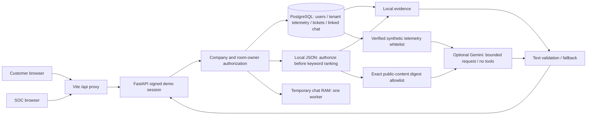
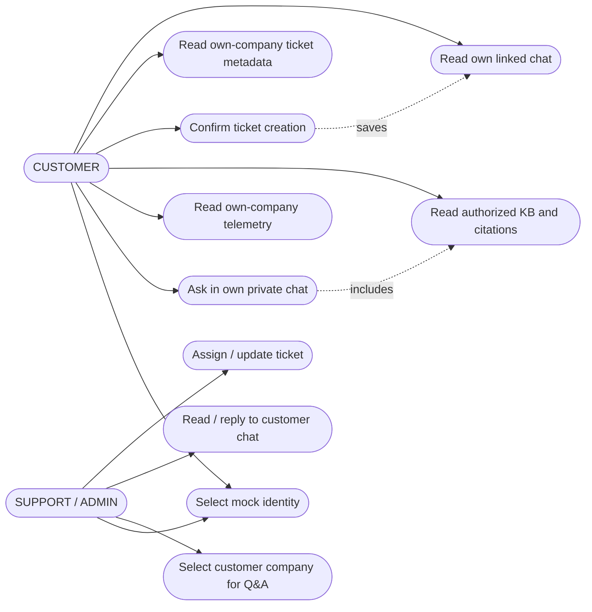
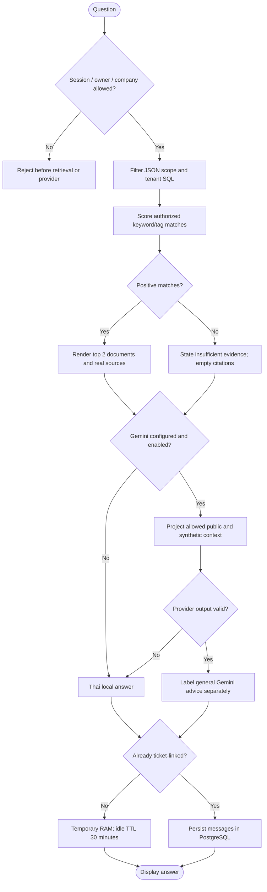

# Phase C — implementation-based diagrams

Scope: React/Vite → FastAPI → PostgreSQL, local JSON KB and optional Gemini. Based on main.py,
routers/{demo_auth,customer_data,customer_chat,chat_rooms,tickets}.py and services/{support_answers,knowledge_base,gemini_support,temporary_chat}.py.
No vector/semantic search, live SIEM ingestion, automated response or production authentication is claimed.

## System Architecture



Question text is processed locally; only fixed topic enums, bounded history topic projections,
approved public KB text and whitelisted synthetic telemetry go to Gemini. In the browser evaluation,
Gemini is disabled and Thai deterministic fallback is displayed. Private KB is local-only.

## Use Case Diagram



Mock user selection is not identity assurance. Internal staff may see all chat rooms or filter them;
company Q&A requires explicit selection. Same-company customers share ticket metadata, not transcripts.

## Sequence Diagram — customer chat

```mermaid
sequenceDiagram
    actor C as Customer
    participant UI as React
    participant API as FastAPI
    participant DB as PostgreSQL
    participant KB as JSON KB
    participant AI as Optional Gemini
    C->>UI: Send question
    UI->>API: Bearer session + room ID + content
    API->>DB: Resolve signed user; check owner/company
    alt Unauthorized
        API-->>UI: 401 / 403 / 404
    else Authorized
        API->>DB: Company-filtered assets/collectors/logs
        API->>KB: Filter scope before ranking; top 2 keyword matches
        KB-->>API: Authorized documents and sources
        alt AI enabled and configured
            API->>AI: Approved public KB + fixed topics + verified mock data
            AI-->>API: Plain Thai advice or failure
        end
        API->>API: Validate output; local citations; Thai fallback if needed
        API->>API: Append to temporary RAM or existing linked room
        API-->>UI: Messages including source links
    end
    C->>UI: Explicitly confirm ticket
    UI->>API: Subject + room ID
    API->>DB: Atomic ticket / room / messages transaction
    API-->>UI: Durable ticket-linked history
```

## Activity Diagram



No-match can still receive general advice if the provider is enabled; the local no-match disclaimer
remains and no KB citation is invented. Validation is structural, not proof of factual accuracy.
